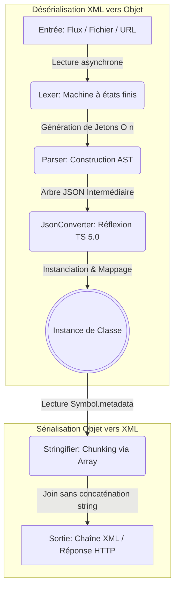
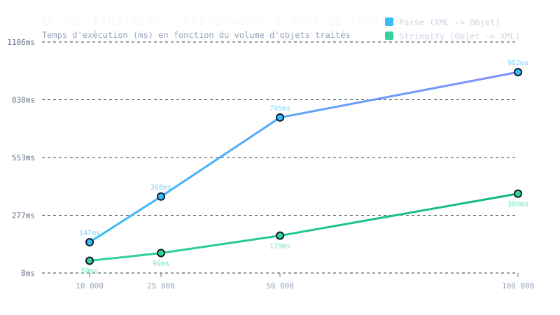

# xml-airstream

*[Read this documentation in English](./README.md)*

XML Airstream est un parseur, sérialiseur et ODM (Object-Document Mapper) XML asynchrone ultra-rapide et orienté flux pour TypeScript et JavaScript.  

Il permet de transformer des flux ou des fichiers XML complexes directement en instances de classes fortement typées, et inversement, grâce à un système de décorateurs moderne et performant.

## Sommaire
1. [Pourquoi choisir xml-airstream ?](#pourquoi-choisir-xml-airstream-)
2. [Architecture et Fonctionnement](#architecture-et-fonctionnement)
3. [Installation](#installation)
4. [Démarrage rapide](#démarrage-rapide)
5. [Fonctionnalités Avancées (Transformations)](#fonctionnalités-avancées-transformations)
6. [Exemple Complet](#exemple-complet-cas-dusage-complexes)
7. [Méthodes de la classe Xml](#methodes)
8. [Décorateurs](#décorateurs)
9. [Options de Configuration](#options-de-configuration-xmloptions)
10. [Notes pour les Développeurs Expérimentés (Technique)](#notes-pour-les-développeurs-expérimentés-technique)

## Pourquoi choisir xml-airstream ?
- **Orienté Flux (Streaming)** : Conçu pour traiter des fichiers XML volumineux sans saturer la mémoire RAM.
- **Décorateurs Natifs (TS 5.0+)** : Utilise la norme moderne `Symbol.metadata` sans dépendance lourde tierce (type `reflect-metadata`).
- **Mappage Complet** : Gère les attributs, les éléments imbriqués, les tableaux, les sections `CDATA`, les valeurs textuelles mixtes et les types complexes (`Date`, `boolean`, `number`).
- **Transformations à la volée** : Permet de formater et filtrer les données dynamiquement lors de la lecture et de l'écriture (`transformRead`, `transformWrite`).
- **Polyvalent** : Parse nativement depuis des `Buffers`, des `ReadableStream`, des fichiers locaux ou des requêtes HTTP (URL).

## Architecture et Fonctionnement

Le moteur de `xml-airstream` repose sur une architecture découplée pour garantir des performances optimales. 

Voici le cycle de vie des données, de l'entrée XML jusqu'à l'objet TypeScript (et inversement) :



## Installation

```bash
npm install @jetonpeche/xml-airstream
```
*(Assurez-vous d'utiliser TypeScript 5.0 ou supérieur avec `target: "es2022"` ou supérieur).*

## Démarrage rapide

```ts
import { Xml, XmlRoot, XmlElement, XmlAttribute } from 'xml-airstream';

@XmlRoot('User')
class User 
{
    @XmlAttribute('id')
    public id: number = 0;

    @XmlElement('FullName')
    public name: string = '';
}

async function run() 
{
    const xml = `<User id="42"><FullName>Jean Dupont</FullName></User>`;
    
    // Parsing (XML -> Objet)
    const user = await Xml.parse(Buffer.from(xml), User);
    console.log(user instanceof User); // true
    console.log(user.name); // "Jean Dupont"
    console.log(user.id);   // 42 (converti automatiquement en nombre)

    // Sérialisation (Objet -> XML)
    const xmlOutput = Xml.stringify(user, { format: true });
    console.log(xmlOutput);
}

run();
```

## Fonctionnalités Avancées (Transforms)

`xml-airstream` offre une API puissante pour modifier ou ignorer des données à la volée grâce aux options `transformRead`, `transformWrite`, `ignoreRead`, et `ignoreWrite`.

```typescript
class Product {
    // Transforme la valeur entrante et sortante
    @XmlElement({
        name: 'Title',
        transformRead: (val: string) => val.trim().toLowerCase(),
        transformWrite: (val: string) => val.toUpperCase()
    })
    public title: string = '';

    // Ignore conditionnellement l'export si le prix est à 0
    @XmlElement('Price')
    @XmlIgnore({
        ignoreWrite: (val: number) => val === 0
    })
    public price: number = 0;
}
```

## Exemple Complet (Cas d'usage complexes)

Cet exemple met en œuvre des structures imbriquées, des listes enveloppées (`@XmlArray`), des attributs combinés à du texte (`@XmlValue`), du code protégé (`@XmlCData`), et des exclusions absolues (`@XmlIgnore`).

```ts
import { 
    Xml, XmlRoot, XmlElement, XmlAttribute, 
    XmlArray, XmlValue, XmlCData, XmlIgnore 
} from 'xml-airstream';

class Price {
    @XmlAttribute('currency')
    public currency: string = 'EUR';

    @XmlValue()
    public amount: number = 0;
}

class Item {
    @XmlElement('Title')
    public title: string = '';

    @XmlElement('Description')
    @XmlCData() // Protège les balises HTML ou caractères spéciaux
    public description: string = '';
}

@XmlRoot('Order')
class Order {
    @XmlAttribute('id')
    public id: number = 0;

    @XmlElement('OrderDate')
    public date: Date = new Date();

    @XmlElement('IsExpress')
    public isExpress: boolean = false;

    @XmlElement('Total')
    public total: Price = new Price();

    // Liste avec balise conteneur <Items><Product>...</Product></Items>
    @XmlArray({
        rootName: 'Items',
        itemName: 'Product',
        itemType: Item,
        transformRead: (items: Item[]) => items.filter(i => i.title !== 'invalide')
    })
    public items: Item[] = [];

    @XmlIgnore()
    public internalId: string = 'SECRET_123'; // Ignoré à l'export/import
}

async function runAdvanced() 
{
    // Lecture depuis une URL directement !
    // const order = await Xml.parseFromUrl('https://api.monsite.com/order.xml', Order);
    
    const xmlData = `
        <Order id="1001">
            <OrderDate>2026-06-01T12:00:00Z</OrderDate>
            <IsExpress>OUI</IsExpress>
            <Total currency="USD">149.99</Total>
            <Items>
                <Product>
                    <Title>Livre TypeScript</Title>
                    <Description><![CDATA[Livre <b>avancé</b> pour dev web.]]></Description>
                </Product>
            </Items>
        </Order>
    `;

    // Parsing avec configuration des booléens personnalisés (ex: "OUI")
    const order = await Xml.parse(Buffer.from(xmlData), Order, {
        trueValues: ['oui', 'yes', '1', 'vrai']
    });

    console.dir(order, { depth: null });

    // Sérialisation inverse
    const backToXml = Xml.stringify(order, { format: true });
    console.log(backToXml);
}

runAdvanced();
```

## Methodes

| Nom | Description |
|:--- |:--- |
| `Xml.parse(input, targetClass, options?)` | Désérialise un flux ou un buffer XML vers une instance de classe. |
| `Xml.parseFromUrl(url, targetClass, options?)`| Récupère et désérialise un fichier XML distant via une requête `fetch` asynchrone (optimisé par flux). |
| `Xml.parseFromFile(path, targetClass, options?)`| Lit et désérialise un fichier XML stocké sur le disque local (Node.js/Bun). |
| `Xml.stringify(instance, options?)` | Sérialise une instance de classe décorée en chaîne de caractères XML. |
| `Xml.toJson(input, options?)` | Convertit un flux ou un buffer XML brut en un objet JSON (AST) léger. |
| `Xml.fromJson(json, rootName, options?)` | Convertit un objet JSON simple en chaîne XML en l'enveloppant dans une balise racine. |
| `Xml.saveToFile(instance, path, options?)` | Sérialise un objet en XML et l'écrit directement sur le système de fichiers local. |
| `Xml.sendToApi(instance, endpoint, options?)` | Sérialise un objet en XML et l'envoie via une requête HTTP POST vers une API distante. |
| `Xml.toResponse(instance, options?)` | Génère une `Response` HTTP Web standard prête à l'emploi (Next.js, Bun, serveurs natifs). |

## Décorateurs

| Nom | Cible | Description |
|:--- |:--- |:--- |
| `@XmlRoot(name)` | `Classe` | Définit le nom de la balise racine XML associée à la classe. |
| `@XmlElement(options)` | `Propriété` | Mappe une propriété à une balise enfant. Gère `transformRead` et `transformWrite`. |
| `@XmlAttribute(options)` | `Propriété` | Mappe une propriété de classe vers un attribut XML de la balise parente. |
| `@XmlArray(options)` | `Propriété` | Gère les listes avec balise parente (`rootName`) et élément (`itemName`). |
| `@XmlValue(options)` | `Propriété` | Récupère le texte brut d'une balise possédant également des attributs. |
| `@XmlCData()` | `Propriété` | Enveloppe la chaîne dans un bloc `<![CDATA[ ... ]]>` (désactive l'échappement XML). |
| `@XmlIgnore(options?)` | `Propriété` | Ignore la propriété (de façon absolue ou conditionnelle via `ignoreRead`/`ignoreWrite`). |

## Options de Configuration (`XmlOptions`)

Lors de l'appel aux méthodes de la classe `Xml`, vous pouvez passer les options globales suivantes :
- `format?: boolean` : Si `true`, indente le XML généré avec des retours à la ligne (Pretty Print).
- `ignoreAttributes?: boolean` : Ignore tous les attributs XML lors du parsing.
- `trueValues?: string[]` : Tableau de chaînes de caractères reconnues comme `true` pour les propriétés de type `boolean` (par défaut : `['true', '1']`).
- `encoding?: string` : Encodage utilisé pour la lecture des buffers/flux (par défaut : `'utf-8'`).

## Benchmark et test de charge

Test d'intégrité et de charge mesuré avec `performance.now()` sur une structure de catalogue e-commerce typée (contenant attributs, éléments imbriqués et blocs CDATA) :

| Objets traités | Poids XML | Sérialisation (`stringify`) | Parsing (`parse`) | Débit Parsing | Mémoire RAM allouée |
| :--- | :--- | :--- | :--- | :--- | :--- |
| **10 000** | ~1.98 Mo | **60.6 ms** | **168.2 ms** | ~11.8 Mo/s | ~55 Mo |
| **25 000** | ~4.99 Mo | **94.6 ms** | **422.4 ms** | ~11.8 Mo/s | ~46 Mo |
| **50 000** | ~10.02 Mo | **220.9 ms** | **790.5 ms** | ~12.7 Mo/s | ~103 Mo |
| **100 000** | ~20.07 Mo | **375.8 ms** | **970.3 ms** | **~20.7 Mo/s** | ~156 Mo |

### Visualisation des Performances



> **Observations :** L'analyse caractère par caractère via l'automate d'états finis (`EtatLexer`) conserve une complexité strictement linéaire *O(n)*, traitant 100 000 entités en moins d'une seconde sans saturer le ramasse-miettes (GC).

## Notes pour les Développeurs Expérimentés (Technique)

### 1. Implémentation sous le capot (TypeScript 5.0+ Decorators)
Contrairement aux anciennes versions de TypeScript (qui dépendaient du drapeau expérimental `experimentalDecorators` et de la librairie externe `reflect-metadata`), cette librairie s'appuie entièrement sur la **Stage 3 Decorators API** et la proposition ECMAScript **`Symbol.metadata`**.

- **Stockage décentralisé**: Les métadonnées sont injectées directement dans l'objet `context.metadata` fourni par le runtime du décorateur de classe/propriété. Cela évite les fuites de mémoire et les collisions de clés globales.
- **Typage strict** : Les signatures de décorateurs exigent le paramètre `value: undefined` pour les champs de classe (Field Decorators), conformément aux spécifications ECMAScript actuelles.

### 2. Architecture de Parsing (Séparation des préoccupations)
Le processus de désérialisation est volontairement divisé en deux couches isolées (via un AST intermédiaire) :
1. **Couche I/O (Lexer & Parser)** : Construit un AST JSON simple (Abstract Syntax Tree) sans se soucier du mapping des classes. Le Lexer analyse caractère par caractère sans regex complexes, garantissant une complexité $O(n)$.
2. **Couche Mappage (JsonConverter)** : Parcourt l'AST en appliquant les règles définies par les métadonnées (types, conversions, transformations).

### 3. Performance du Moteur (Streaming & Mémoire)
- **Traitement Asynchrone (ReadableStream)** : Lors de la réception d'une réponse API via `fetch` (ex: `Xml.parseFromUrl`), le corps de la réponse n'est jamais chargé intégralement en mémoire. Les fragments de données (chunks) sont transmis au Lexer à la volée, permettant de traiter de très gros fichiers.
- **Chunking de chaînes (Stringifier)** : L'écriture n'utilise pas la concaténation de chaînes récursive basique (qui crée de nombreux objets partiels coûteux en mémoire), mais accumule des fragments textuels dans un `Array` avant un appel final à `.join('')`, optimisant drastiquement le comportement du Garbage Collector (GC) sous V8 (Node.js/Chrome).