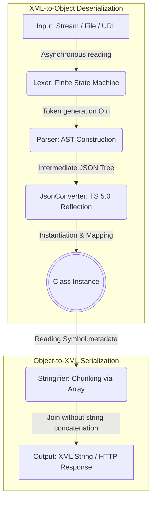

# xml-airstream

*[Documentation en français](https://github.com/jetonpecheCorp/xml-airstream/blob/main/README.fr.md)*

XML Airstream is an ultra-fast, stream-oriented, asynchronous XML parser, serializer, and ODM (Object-Document Mapper) for TypeScript and JavaScript.

It enables the transformation of complex XML streams or files directly into strongly typed class instances—and vice versa—using a modern, high-performance decorator system.

## Table of Contents
1. [Why choose xml-airstream?](#why-choose-xml-airstream-)
2. [Architecture and Operation](#architecture-and-operation)
3. [Installation](#installation)
4. [Quick Start](#quick-start)
5. [Advanced Features (Transformations)](#advanced-features-transformations)
6. [Complete Example](#complete-example-complex-use-cases)
7. [Xml Class Methods](#methods)
8. [Decorators](#decorators)
9. [Configuration Options](#configuration-options-xmloptions)
10. [Notes for Experienced Developers (Technical)](#notes-for-experienced-developers-technical)

## Why choose xml-airstream?
- **Stream-Oriented (Streaming)**: Designed to process large XML files without exhausting RAM.
- **Native Decorators (TS 5.0+)**: Uses the modern `Symbol.metadata` standard without heavy third-party dependencies (like `reflect-metadata`).
- **Comprehensive Mapping**: Handles attributes, nested elements, arrays, `CDATA` sections, mixed text content, and complex types (`Date`, `boolean`, `number`). - **On-the-fly transformations**: Allows for dynamic data formatting and filtering during read and write operations (`transformRead`, `transformWrite`).
- **Versatile**: Natively parses from `Buffers`, `ReadableStream`s, local files, or HTTP requests (URLs).

## Architecture and Operation

The `xml-airstream` engine relies on a decoupled architecture to ensure optimal performance.

Here is the data lifecycle, from XML input to TypeScript object (and vice versa):



## Installation

```bash
npm install @jetonpeche/xml-airstream
```
*(Ensure you are using TypeScript 5.0 or higher with `target: "es2022"` or higher).*

## Quick Start

```ts
import { Xml, XmlRoot, XmlElement, XmlAttribute } from 'xml-airstream';

@XmlRoot('User')
class User 
{
    @XmlAttribute('id')
    public id: number = 0;

    @XmlElement('FullName')
    public name: string = '';
}

async function run() 
{
    const xml = `<User id="42"><FullName>Jean Dupont</FullName></User>`;
    
    // Parsing (XML -> Objet)
    const user = await Xml.parse(Buffer.from(xml), User);
    console.log(user instanceof User); // true
    console.log(user.name); // "Jean Dupont"
    console.log(user.id);   // 42 (automatically converted to a number)

    // Serialization (Objet -> XML)
    const xmlOutput = Xml.stringify(user, { format: true });
    console.log(xmlOutput);
}

run();
```

## Advanced Features (Transforms)

`xml-airstream` offers a powerful API for modifying or ignoring data on the fly using the `transformRead`, `transformWrite`, `ignoreRead`, and `ignoreWrite` options.

```typescript
class Product {
    // Transforme la valeur entrante et sortante
    @XmlElement({
        name: 'Title',
        transformRead: (val: string) => val.trim().toLowerCase(),
        transformWrite: (val: string) => val.toUpperCase()
    })
    public title: string = '';

    // Conditionally ignore the export if the price is 0
    @XmlElement('Price')
    @XmlIgnore({
        ignoreWrite: (val: number) => val === 0
    })
    public price: number = 0;
}
```

## Comprehensive Example (Complex Use Cases)

This example demonstrates nested structures, wrapped lists (`@XmlArray`), attributes combined with text (`@XmlValue`), protected code (`@XmlCData`), and absolute exclusions (`@XmlIgnore`).

```ts
import { 
    Xml, XmlRoot, XmlElement, XmlAttribute, 
    XmlArray, XmlValue, XmlCData, XmlIgnore 
} from 'xml-airstream';

class Price {
    @XmlAttribute('currency')
    public currency: string = 'EUR';

    @XmlValue()
    public amount: number = 0;
}

class Item {
    @XmlElement('Title')
    public title: string = '';

    @XmlElement('Description')
    @XmlCData() // Protects HTML tags or special characters
    public description: string = '';
}

@XmlRoot('Order')
class Order {
    @XmlAttribute('id')
    public id: number = 0;

    @XmlElement('OrderDate')
    public date: Date = new Date();

    @XmlElement('IsExpress')
    public isExpress: boolean = false;

    @XmlElement('Total')
    public total: Price = new Price();

    // List with <Items><Product>...</Product></Items> container tag
    @XmlArray({
        rootName: 'Items',
        itemName: 'Product',
        itemType: Item,
        transformRead: (items: Item[]) => items.filter(i => i.title !== 'invalide')
    })
    public items: Item[] = [];

    @XmlIgnore()
    public internalId: string = 'SECRET_123'; // Ignored during export/import
}

async function runAdvanced() 
{
    // Read directly from a URL!
    // const order = await Xml.parseFromUrl('https://api.mywebsite.com/order.xml', Order);
    
    const xmlData = `
        <Order id="1001">
            <OrderDate>2026-06-01T12:00:00Z</OrderDate>
            <IsExpress>YES</IsExpress>
            <Total currency="USD">149.99</Total>
            <Items>
                <Product>
                    <Title>TypeScript Book</Title>
                    <Description><![CDATA[<b>advanced</b> book for web dev.]]></Description>
                </Product>
            </Items>
        </Order>
    `;

    // Parsing with custom boolean configuration (ex: "YES")
    const order = await Xml.parse(Buffer.from(xmlData), Order, {
        trueValues: ['oui', 'yes', '1', 'vrai']
    });

    console.dir(order, { depth: null });

    // Reverse serialization
    const backToXml = Xml.stringify(order, { format: true });
    console.log(backToXml);
}

runAdvanced();
```

## Methods

| Name | Description |
|:--- |:--- |
| `Xml.parse(input, targetClass, options?)` | Deserializes an XML stream or buffer to a class instance. |
| `Xml.parseFromUrl(url, targetClass, options?)`| Retrieves and deserializes a remote XML file via an asynchronous `fetch` request (stream-optimized). |
| `Xml.parseFromFile(path, targetClass, options?)`| Reads and deserializes an XML file stored on local disk (Node.js/Bun). |
| `Xml.stringify(instance, options?)` | Serializes a decorated class instance into an XML string. |
| `Xml.toJson(input, options?)` | Converts a raw XML stream or buffer into a lightweight JSON (AST) object. |
| `Xml.fromJson(json, rootName, options?)` | Converts a simple JSON object to an XML string by wrapping it in a root tag. |
| `Xml.saveToFile(instance, path, options?)` | Serializes an object to XML and writes it directly to the local file system. |
| `Xml.sendToApi(instance, endpoint, options?)` | Serializes an object to XML and sends it via an HTTP POST request to a remote API. |
| `Xml.toResponse(instance, options?)` | Generates a standard ready-to-use HTTP Web `Response` (Next.js, Bun, native servers). |

## Decorators

| Name | Target | Description |
|:--- |:--- |:--- |
| `@XmlRoot(name)` | `Class` | Defines the name of the XML root tag associated with the class. |
| `@XmlElement(options)` | `Property` | Maps a property to a child tag. Supports `transformRead` and `transformWrite`. |
| `@XmlAttribute(options)` | `Property` | Maps a class property to an XML attribute of the parent tag. |
| `@XmlArray(options)` | `Property` | Handles lists with a parent tag (`rootName`) and item tag (`itemName`). |
| `@XmlValue(options)` | `Property` | Retrieves the raw text content of a tag that also has attributes. |
| `@XmlCData()` | `Property` | Wraps the string in a `<![CDATA[ ... ]]>` block (disables XML escaping). |
| `@XmlIgnore(options?)` | `Property` | Ignores the property (unconditionally or conditionally via `ignoreRead`/`ignoreWrite`). |

## Configuration Options (`XmlOptions`)

When calling methods on the `Xml` class, you can pass the following global options:
- `format?: boolean`: If `true`, indents the generated XML with line breaks (Pretty Print).
- `ignoreAttributes?: boolean`: Ignores all XML attributes during parsing.
- `trueValues?: string[]`: Array of strings recognized as `true` for `boolean` properties (default: `['true', '1']`).
- `encoding?: string`: Encoding used for reading buffers/streams (default: `'utf-8'`).

## Benchmark and Load Test

Integrity and load test measured using `performance.now()` on a typed e-commerce catalog structure (containing attributes, nested elements, and CDATA blocks):

| Objects Processed | XML Size | Serialization (`stringify`) | Parsing (`parse`) | Parsing Throughput | Allocated RAM |
| :--- | :--- | :--- | :--- | :--- | :--- |
| **10 000** | ~1.98 Mo | **58.6 ms** | **147.3 ms** | ~13.4 Mo/s | ~28.1 Mo |
| **25 000** | ~4.99 Mo | **95.5 ms** | **366.1 ms** | ~13.6 Mo/s | **~4.6 Mo** |
| **50 000** | ~10.02 Mo | **178.9 ms** | **744.5 ms** | ~13.4 Mo/s | ~32.9 Mo |
| **100 000** | ~20.07 Mo | **379.9 ms** | **961.8 ms** | **~20.8 Mo/s** | ~166.5 Mo |

### Performance Visualization


> **Observations:** Character-by-character analysis via the finite state automaton (possEtatLexerʼ) maintains a strictly linear complexity *O(n)*, processing 100,000 entities in less than a second. The just-in-time architecture greatly minimizes the intermediate memory footprint.

## Notes for Experienced Developers (Technical)

### 1. Under-the-Hood Implementation (TypeScript 5.0+ Decorators)
Unlike older versions of TypeScript (which relied on the `experimentalDecorators` flag and the external `reflect-metadata` library), this library relies entirely on the **Stage 3 Decorators API** and the ECMAScript **`Symbol.metadata`** proposal.

- **Decentralized Storage**: Metadata is injected directly into the `context.metadata` object provided by the class/property decorator runtime. This avoids memory leaks and global key collisions.
- **Strict Typing**: Decorator signatures require the `value: undefined` parameter for class fields (Field Decorators), in accordance with current ECMAScript specifications.

### 2. Parsing Architecture (Separation of Concerns)
The deserialization process is intentionally split into two isolated layers (via an intermediate AST):
1. **I/O Layer (Lexer & Parser)**: Builds a simple JSON AST (Abstract Syntax Tree) without concerning itself with class mapping. The Lexer analyzes input character-by-character without complex regex, ensuring $O(n)$ complexity.
2. **Mapping Layer (JsonConverter)**: Traverses the AST while applying rules defined by the metadata (types, conversions, transformations).

### 3. Engine Performance (Streaming & Memory)
- **Asynchronous Processing (ReadableStream)**: When receiving an API response via `fetch` (e.g., `Xml.parseFromUrl`), the response body is never fully loaded into memory. Data chunks are streamed to the Lexer on the fly, enabling the processing of very large files. - **String Chunking (Stringifier)** : The writing process avoids basic recursive string concatenation (which creates numerous memory-intensive intermediate objects) and instead accumulates text fragments in an `Array` before a final call to `.join('')`, drastically optimizing Garbage Collector (GC) behavior in V8 (Node.js/Chrome).
